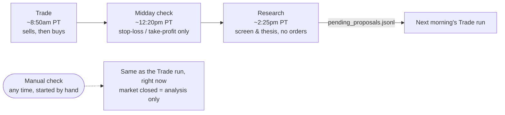
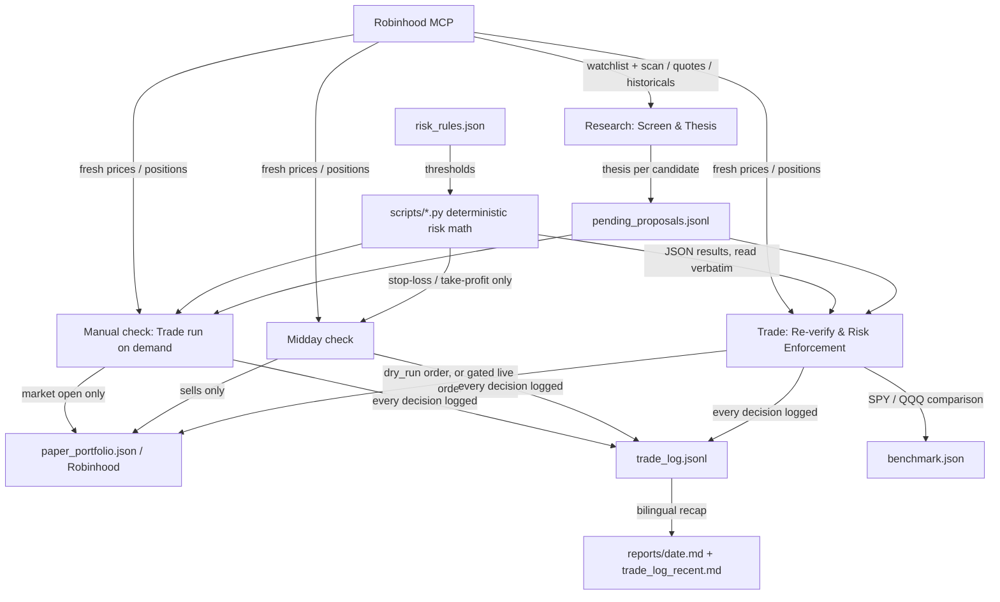
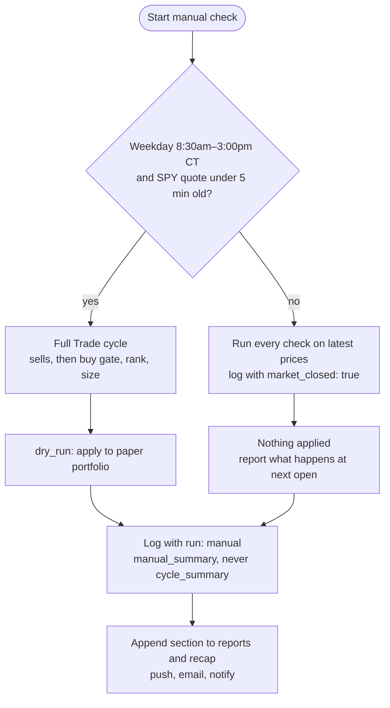

# Agentic Trader

An AI trading agent for [Robinhood](https://robinhood.com),
built on Robinhood's
[Agentic Trading MCP server](https://robinhood.com/us/en/agentic-trading/).
Scheduled Claude sessions screen stocks, write out their reasoning, and
enforce mechanical, auditable risk rules on every trade. The safety
mechanism is the rules, not the model's judgment.

It includes a dry-run paper portfolio, an SPY/QQQ benchmark, a midday
stop-loss check, an on-demand manual check, stop-level price alerts,
bilingual daily reports, and strict account-isolation and privacy rules.

Read "What this does and doesn't solve" below before pointing it at
real money.

**Contents:** [Quick start for AI agents](#quick-start-for-ai-agents) ·
[Why this is safer than it sounds](#why-this-is-safer-than-it-sounds) ·
[Requirements](#requirements) · [How it works](#how-it-works) ·
[Repository layout](#repository-layout) · [See it in action](#see-it-in-action) ·
[What this does and doesn't solve](#what-this-does-and-doesnt-solve) ·
[Setup](#setup) · [Configuration](#configuration) · [Running it](#running-it) ·
[Going live](#going-live) · [FAQ](#faq) · [License](#license)

## Quick start for AI agents

If you are an AI agent setting this repo up for a person, follow these
steps in order. Humans can follow them too; the rest of this README
explains the why.

**Never, during setup:** place, review, or cancel orders; change
`execution.mode` (it stays `"dry_run"`) or any threshold in
`risk_rules.json` unless the person asks; write an account number,
email address, or filled-in prompt into any file in the repo; read or
use any Robinhood account other than the one the person names.

**1. Ask the person for these values** (don't guess them):

| Value | Used for |
|---|---|
| The agentic-trading account number | `<ACCOUNT_NUMBER>` in every prompt. You can list accounts with the Robinhood MCP's `get_accounts`, but the person must confirm which one. |
| Every Robinhood account number they own | `<ACCOUNT_NUMBER_PATTERN>`, joined with `\|`, so the pre-commit privacy grep catches any of them |
| Their private GitHub repo (`owner/name`) holding a copy of this code | `<GITHUB_OWNER>` / `<REPO>`; the runs push logs to it |
| The email address for reports | `<YOUR_EMAIL>` |
| Watchlist name and symbols (up to 40), or "use the default" | `universe.watchlist_name` (default `"Agent"`) |

**2. Prepare the repo.** If their private copy doesn't exist yet, have
them create an empty private repo, then push this code into it (see
Setup step 1). Work in their copy from here on.

**3. Check the connections.** Confirm the Robinhood MCP connector
answers (`get_accounts`), and that a Gmail connector is available if
they want report emails. Call `get_trade_approval_setting` for the
account and tell them whether trade approval is on; it must be on
before they ever go live.

**4. Set up the universe.**
- Watchlist: `get_watchlists`; if none matches `universe.watchlist_name`,
  create it with `create_watchlist` and add their symbols with
  `add_to_watchlist`. If they chose a different name, set
  `universe.watchlist_name` to it.
- Scan (optional): create one with `create_scan` and put its ID in
  `universe.supplementary_scan_id`. Leaving `"YOUR_SCAN_ID_HERE"` skips
  the scan.
- These two fields are the only `risk_rules.json` edits setup needs.

**5. Verify locally**, from the repo root:
```
python3 -c "import json; json.load(open('risk_rules.json')); print('risk_rules.json OK')"
echo '[{"symbol":"AAA","group":"new","conviction":"high"}]' | python3 scripts/position_sizing.py --total-value 500 --cash-start 500 --concurrent-positions-start 0 --max-position-pct 0.12 --max-concurrent-positions 8 --min-cash-buffer-pct 0.05 --min-top-up-usd 5 --min-top-up-pct-of-target 0.10 --conviction-pct "high:0.12,medium:0.08,low:0.05" --min-new-position-usd 10
grep -rnE '<ACCOUNT_NUMBER_PATTERN>' --exclude-dir=.git . || echo "no account numbers in repo"
```
The second command should print JSON with `"passed": true` and
`"dollar_amount": 60.0`. In the third, substitute the real account
numbers for the placeholder only on the command line, never in a file. Every script needs only Python 3's standard
library. Commit and push the `risk_rules.json` changes.

**6. Create the five scheduled tasks.** For each file in `prompts/`,
copy its full text into a new scheduled task, replace every
placeholder, and give the task the Robinhood connector, the Gmail
connector (if used), and push access to their repo. Schedules (Pacific
time): Trade `52 8 * * 1-5`, Midday `22 12 * * 1-5`, Research
`23 14 * * 0-5`, Weekly review `7 9 * * 6`, Manual check with no
schedule. Check that no `<...>`
placeholder is left in any task.

**7. First run.** Start the Research task once by hand. It should push
a non-empty `pending_proposals.jsonl` and a `reports/<date>.md` with a
Research section, then email the report. The Trade task then runs on
its schedule in dry run.

**8. Hand back to the person** with: the account number's last 4
digits only, the watchlist used, whether trade approval is on, the
task names and schedules, the first run's result, and a reminder that
going live is their manual change (see Going live).

## Why this is safer than it sounds

"Fully autonomous" and "trading real money" together should make you
nervous. Here's what actually stands between a thesis and an order:

- **Every trade passes through mechanical rules the LLM cannot
  override** — position sizing, stop-loss, take-profit, loss limits, a
  wash-sale guard, each computed by a small stdlib-only Python script in
  `scripts/` rather than the model doing arithmetic in prose. Same
  inputs always produce the same numbers, and a good story never cancels
  a stop-loss.
- **New deployments start in `dry_run` and stay there** for a minimum
  number of cycles (`dry_run_min_cycles_before_live`) before a live
  order is even possible, so you can watch it screen and reason before
  it touches real money.
- **Only you can flip `execution.mode` to `"live"`** — the agent is
  explicitly barred from ever changing this itself, and refuses to
  place live orders while `dry_run`.
- **Every decision is logged, approved or rejected** — `trade_log.jsonl`
  is append-only, so you can check whether the reasoning is actually
  sound, not just trust it.

## Requirements

- A [Robinhood](https://robinhood.com) account with
  [Agentic Trading](https://robinhood.com/us/en/agentic-trading/) enabled,
  connected via Robinhood's own MCP server.
- [Claude Code](https://claude.com/claude-code), on a Pro subscription or
  higher, with scheduled tasks available to you.
- A GitHub account, to host your own **private** copy of this repo. Each
  run clones it, commits its logs and reports, and pushes back, so the
  scheduled tasks need push access to it.
- Optional but recommended: a Gmail connector in Claude, so every run
  can email you its full report. Without it the run still completes and
  says the email failed.
- Robinhood's **trade approval** turned on for the agentic account
  before you go live. With it on, every order the agent submits waits
  for you to approve or decline it in the Robinhood app; with it off,
  the runs refuse to submit anything.

## How it works

Trading runs as **two separate phases, on two separate schedules** — a
full trading day's closing data feeds the thesis, and a fresh opening
price is used for the actual order, rather than trading on a stale
overnight price. Two more runs guard held positions in between: a
scheduled midday check, and a manual check you can start at any time.

### A trading day



Every run is a fresh cloud session: it clones this repo, follows its
spec, appends a bilingual section to `reports/<date>.md`, pushes back to
`main`, emails the full report, and sends a one-line notification.

### How data flows



Only one step is a judgment call — the Research thesis. Every filter,
ranking, and size is a deterministic script.

**Research — screen and write a thesis** (Steps 1–3, ~4:25pm Central
weekdays and Sunday, so weekend news reaches Monday's proposals; it also
runs by hand on any day, using the last session's data; spec
`RESEARCH_TASK.md`). Places no orders.

1. **Universe.** Start with your watchlist (up to
   `universe.watchlist_max_candidates`), plus up to
   `universe.supplementary_scan_max_candidates` movers from your saved
   Robinhood scan, plus every position you currently hold. Remove anything
   failing the `universe` filters in `risk_rules.json` — volume,
   market-cap band, minimum price, leveraged/inverse ETFs, price below its
   200-day moving average. Held positions are always kept.
2. **Signal gate.** A candidate is researched only if it meets **any one**
   of `signal_thresholds`: a 60-day price move, a volume spike, or a price
   near its 52-week high or low. The rest are logged `no_signal` with no
   thesis. Held positions are always researched.
3. **Thesis.** The model runs a news search and writes a line to
   `pending_proposals.jsonl`: `direction` (`long` / `avoid` /
   `exit_existing`), `conviction` (`high` / `medium` / `low`, against a
   fixed rubric so the same facts give the same rating), `risk_flags`, and
   percent below the 52-week high. This is the stock selection.

**Trade — re-verify, enforce the rules, place orders** (Steps 4–9,
around 9:00am Pacific weekdays, when you can approve orders in the
Robinhood app; spec `TRADE_TASK.md`). Decides which `long`
candidates are bought:

- **Market regime and core sleeve.** SPY and QQQ technicals decide
  whether the market is risk-off (SPY below its 50-day average) and
  which ETF, if any, holds the ~25% core sleeve (QQQ, else SPY, else
  cash, whichever is above both its 50- and 200-day averages).
- **Re-verify.** Re-check each proposal against the opening price. Run all
  sells (stop-loss, take-profit, `exit_existing`) before any buy. Every
  run also searches for news since the Research run's thesis (overnight earnings,
  downgrades, legal or regulatory news): a buy is dropped if the news
  breaks its thesis, and bad news on a held position is flagged at the
  top of the report (it never sells by itself). Stops
  (`stop_loss.py`) are set from the conviction at entry: a multiple of
  ATR, placed under support when that fits, ratcheting up only, and
  never more than a 20% loss.
- **Classify.** Each candidate is a trend buy, a pullback buy (Mag 7, TSM,
  ASML, or SMH at least 10% off the high and technically stabilizing, bought in
  two half-size tranches, even below the 200-day average), an ETF
  (rated by its own `etf_conviction` rubric), or a defensive name (at
  most one, only when risk-off).
- **Loss limits.** Losing 5% in a day or 10% in a week halves new sizes
  for 3 trading days; only a severe loss (8% / 15%) pauses buying.
- **Buy gate** (`entry_gate.py`). The buy is skipped this cycle if the
  price is more than `entry_price_gap.max_pct` above the thesis price,
  more than `entry_extension.max_extension_pct` above its 20-day average,
  under a wash-sale or sell-re-entry lock, or within
  `earnings_blackout.blackout_trading_days` of its next earnings report.
- **Rank** (`rank_candidates.py`). By conviction, then fewer `risk_flags`,
  then larger percent below the 52-week high.
- **Size** (`position_sizing.py`). In ranked order, each candidate is
  bought at its conviction-tier size (high 12%, medium 8%, low 5% of the
  account; new positions under $10 are skipped) until 8 tactical
  positions or the `min_cash_buffer_pct` floor is reached. While SPY is
  below its 200-day average, new tactical sizes are halved
  (`regime_sizing`; defensive names excepted).
- **Earnings on held positions** (`earnings_risk.py`). Held positions
  with a report within 5 trading days are flagged at the top of the
  report; low-conviction ones are half sold on the last regular session
  before the report, once per report.
- **Sector concentration** (`concentration.py`). Every run reports each
  sector's share of the account, counting the core sleeve's ETF toward
  its sector, and flags any sector above 50%. Information only, never a
  cap.

Every decision is logged to `trade_log.jsonl`. Some cycles buy nothing.

**Example.** `EXAMPLE` is on your watchlist at $40, a $15B-cap trading
above its 200-day average, so it passes the universe filters. It is up 16%
over 60 days, so it meets the price-move threshold and gets a news search;
the model finds a confirmed earnings beat, no risk flags, and rates it
`high` conviction, `long`. Next morning it opens at $40.60, within all
buy-gate limits, and is the only `high`-conviction candidate, so it ranks
first. `high` is 12% of the account: on $500 that is a $60 buy, placed if
the cash buffer holds. Had it opened at $42 — 5% above the thesis price,
over the `entry_price_gap.max_pct` limit — the buy would be skipped that
cycle.

**Weekly review** (Saturday morning Pacific; spec `REVIEW_TASK.md`).
Report-only. Turns the week's fills into closed trades and reports win
rate, average return, and P&L by conviction tier, buy type, and exit
reason, how often each rule fired, how order approvals went (including
any declined risk sells), and the result against SPY and QQQ. It never
trades or changes a rule; it gives you evidence before you tune one.

**Midday risk check** (weekdays around 12:20pm Pacific; spec
`MIDDAY_TASK.md`). Re-checks held positions against the stop-loss and
take-profit rules only, so a sharp intraday move is handled the same day
instead of the next morning. It never buys.

**Manual check** (no schedule, started by hand; spec `MANUAL_TASK.md`).
Runs the full Trade cycle immediately on the current proposals. While
the market is open it behaves exactly like the Trade run; while it is closed
it runs every check on the latest prices for analysis only and reports
what would happen at the next open. It never writes a `cycle_summary`,
so it never counts toward the dry-run cycles needed before going live,
and it never re-buys a proposal an earlier run already decided.

**Dry-run paper portfolio.** In `dry_run` nothing real executes, so
`scripts/paper_portfolio.py` keeps a paper ledger (`paper_portfolio.json`)
of what the account would hold if every dry-run order had filled.
Position limits, stop-losses, take-profits, and loss limits all run
against it, so a dry run behaves like a real account.

**Benchmark.** Every Trade run compares the portfolio (paper in
`dry_run`, real in `live`) against what the same starting money would be
worth in SPY and QQQ (`benchmark.json`), and reports the difference in
`trade_log_recent.md`. The starting point resets when `execution.mode` changes.

**Stop-level alerts.** Each held position gets one Robinhood
`price_below` alert at its stop price, so a sharp drop notifies you in
real time. The agent only touches alert IDs it recorded in
`agent_alerts.json` and never deletes alerts.

**Account isolation.** The agent works only in the dedicated MCP
account and treats it as a standalone account: it never reads or
considers holdings or activity in any other account, and no account
number is ever stored in this repo.

All five runs are designed as cloud-hosted agent sessions,
independent of any local machine — each run clones this repo fresh and
commits/pushes its results back to `main`, so the repo itself is the
persistent state, not local disk. (Running locally instead works too,
but only fires while your machine is on and available at each
scheduled time.)

## Repository layout

- `AGENTS.md` — short instructions for AI agents (setup, scheduled
  runs, changes); `CLAUDE.md` points Claude sessions to it.
- `prompts/` — the five scheduled-task prompts (`research.md`,
  `trade.md`, `midday.md`, `manual.md`, `review.md`) with placeholders for your
  account number, email, and repo. See "Run prompts" below.
- `risk_rules.json` — the hard, mechanical limits (position sizing, stop-
  loss, loss limits, universe filters, execution mode, wash-sale guard).
  Nothing in this system should be able to override these. Several
  fields need your own account details before this is usable — see
  Setup below.
- `scripts/` — the deterministic risk-math engines the Trade run executes instead
  of hand-computing anything, each a standalone Python 3 script (stdlib
  only, no dependencies) you can run and inspect on its own:
  - `entry_gate.py` — the buy gate above, every blocking condition in one
    call (including the pre-earnings blackout).
  - `pnl_pct.py` — daily/weekly loss-limit % against `net_deposits_usd`
    (computed fresh each cycle, see TRADE_TASK.md), and the
    entries-halted decision.
  - `technicals.py` — moving averages, RSI, MACD, ATR, support and
    resistance, relative strength, and the stabilization and
    falling-knife flags, from daily bars.
  - `stop_loss.py` — the conviction-tiered ATR stop (support-aware,
    ratchet-only, 20% hard floor), including the trailing-high reference
    once a take-profit tier has fired, the core-sleeve exit, and the
    trigger decision.
  - `take_profit.py` — tiered partial-exit firing, cascading quantity
    correctly when a single cycle's gain jumps past more than one
    not-yet-fired tier at once.
  - `conviction_trim.py` — mechanically trims a held position back to
    its conviction-tier target after several consecutive
    below-high-conviction, overweight cycles.
  - `rank_candidates.py` — the ranking above (conviction, `risk_flags`,
    `pct_below_52wk_high`); new entries and top-ups compete on one list.
  - `earnings_risk.py` — the pre-earnings flag and low-conviction trim
    for held positions.
  - `concentration.py` — each sector's share of the account and the
    over-threshold flag (report-only).
  - `performance_review.py` — the weekly review's closed-trade stats,
    rule-fire counts, and approval outcomes (report-only).
  - `position_sizing.py` — the sizing above, plus concurrency and
    cash-buffer checks, compounding running totals down the ranked list.

  Each takes plain CLI args, prints one JSON object, and is meant to be
  read from directly rather than re-derived — see `TRADE_TASK.md`
  Steps 5 and 7 for the exact call shape of each
  (`stop_loss.py`/`take_profit.py`/`conviction_trim.py` in Step 5;
  `entry_gate.py`/`pnl_pct.py`/`rank_candidates.py`/`position_sizing.py`
  in Step 7).
- `scripts/paper_portfolio.py` — the dry-run paper ledger and the
  SPY/QQQ benchmark (`paper_portfolio.json`, `benchmark.json`).
- `RESEARCH_TASK.md` / `TRADE_TASK.md` / `MIDDAY_TASK.md` /
  `MANUAL_TASK.md` / `REVIEW_TASK.md` — the spec each run follows. The manual check reuses
  the Trade run's steps and lists only its differences.
- `reports/<date>.md` — the bilingual (English/Chinese) daily record;
  every run that day appends its own section.
- `CLAUDE.md` — standing notes for Claude sessions in this repo (commit
  identity).
- `agent_alerts.json` — the stop-level alert IDs the agent manages.
- `trade_log_template.jsonl` — the log line shapes; real logs accumulate
  in `trade_log.jsonl` in this same style.
- `pending_proposals.jsonl` — the latest Research run's theses,
  overwritten on every Research run (empty until the first one).
- `trade_log.jsonl` / `trade_log_recent.md` — the append-only decision
  log and its human-readable recap (empty until the first run).
- `paper_portfolio.json` / `benchmark.json` — not in a fresh copy; the
  first Trade run creates them.

## See it in action

This is what a real Trade cycle actually produces (`trade_log_recent.md`,
regenerated every run, symbols genericized):

> **2026-07-09**
>
> **Loss limit**: OK — daily 0.0%, weekly -2.1%, within -5%/-10% limits.
>
> **Held positions** (stop-loss / take-profit):
> - EXAMPLE — stop 7.00% (vol-scaled), drawdown -2.3% — holding
>
> **New-entry candidates considered**: OTHER, ANOTHER
> - OTHER — approved: medium conviction, $60.00 (12% of account)
> - ANOTHER — rejected: max_concurrent_positions already filled this cycle
>
> **Orders placed**: OTHER — buy $60.00 (dry_run)

No JSON parsing required to see what it did and why. Full field-level
examples (thesis records, raw `trade_log.jsonl` lines) are further down
in Example output.

## What this does and doesn't solve

- It gives you a structured, auditable version of "let an LLM screen and
  reason about trades" instead of an opaque one.
- It does **not** make LLM-driven stock picking more likely to beat a
  simple index fund — there's no established track record for that, and
  this can't backtest the reasoning step honestly (news-based reasoning
  can't be validated against historical data the model may already know
  the outcome of).
- The risk rules are the actual safety mechanism here, not the reasoning
  quality. Treat loosening them as the highest-risk change you can make
  to this system.
- This is a template extracted from a real deployment trading a small
  personal account, shared for others to learn from or adapt. It is
  genuinely not financial advice, and running it against real money is
  entirely your own decision and risk.

## Setup

1. **Make your own private copy.** Create an empty private repo on
   GitHub, then push this code into it:
   ```
   git clone https://github.com/HarryXiong24/agentic-trader.git
   cd agentic-trader
   git remote set-url origin https://github.com/<you>/<your-repo>.git
   git push -u origin main
   ```
   Every run writes its logs and reports into this copy, so keep it
   private.
2. **Open and fund the agentic account.** Robinhood's
   [Agentic Trading](https://robinhood.com/us/en/agentic-trading/)
   uses a separate, dedicated account, restricted to the funds you put
   in it. The defaults are sized for roughly $500 to $1,500; see
   Configuration to scale them.
3. **Connect Claude.** Add Robinhood's MCP server as a connector (every
   tool call in the specs goes through it), and optionally Gmail for the
   report emails.
4. **Pick the universe.** Create a Robinhood watchlist named `Agent`
   (or change `universe.watchlist_name`) with up to 40 symbols you want
   screened. Optionally create a saved scan with the Robinhood MCP's
   `create_scan` tool and paste its ID into
   `universe.supplementary_scan_id`; while it is still
   `"YOUR_SCAN_ID_HERE"` the scan is skipped.
5. **Review `risk_rules.json`.** It deliberately stores
   `"PROVIDED_IN_RUN_PROMPT"` for `account_number` and
   `wash_sale_avoidance.linked_accounts`: the real account number lives
   only in the scheduled-task prompts, never in this repo. Read every
   threshold (see Configuration) and commit any changes.
6. **Create the five scheduled tasks** from `prompts/`, filling in the
   placeholders, on the schedules in "Running it" below.
7. **Start in dry run.** A fresh copy ships with `execution.mode` set to
   `"dry_run"`. Run the Research task once by hand, then let the Trade
   task run on its schedule. After each cycle, read
   `reports/<date>.md`, `trade_log_recent.md`, and `trade_log.jsonl`,
   especially rejected candidates, stop-loss triggers, and the
   benchmark.
8. **Go live only by hand**, after at least
   `dry_run_min_cycles_before_live` Trade cycles. See Going live. The
   agent never changes `execution.mode` itself.

## Configuration

Everything tunable is in `risk_rules.json`; each section has a `note`
explaining it. The main settings and their defaults:

| Setting | Default | What it controls |
|---|---|---|
| `execution.mode` | `"dry_run"` | `"live"` lets runs submit real orders (you change this by hand only) |
| `execution.dry_run_min_cycles_before_live` | `5` | scheduled Trade cycles required before live orders are possible |
| `universe.watchlist_name` | `"Agent"` | the Robinhood watchlist to screen |
| `universe.supplementary_scan_id` | `"YOUR_SCAN_ID_HERE"` | optional saved scan for extra movers (skipped until set) |
| `universe.min_avg_daily_volume` / `min_market_cap_usd` | 1M shares / $2B | liquidity and size floor |
| `signal_thresholds` | 10% / 2× / 3% | 60-day move, volume spike, distance from 52-week extreme that earn a news search |
| `position_sizing.conviction_pct` | 12% / 8% / 5% | position size for high / medium / low conviction |
| `position_sizing.max_position_pct_of_account` | 12% | largest any single position may be |
| `position_sizing.max_concurrent_positions` | `8` | tactical positions (the core sleeve doesn't count) |
| `position_sizing.min_cash_buffer_pct` | 5% | cash always left uninvested |
| `position_sizing.min_new_position_usd` | $10 | smaller new positions are skipped |
| `stop_loss.tiers` / `hard_floor_pct` | 3.0 / 2.5 / 2.0 × ATR, 20% | conviction-tiered stops and the maximum loss on any position |
| `take_profit.tiers` | +15% / +30% / +50% | each sells 25% of the position once |
| `loss_limits` | 5% day / 10% week | halve new sizes for 3 days; 8% / 15% pauses buying |
| `core_sleeve` | 25% in QQQ, else SPY | trend-following index position |
| `pullback_mode.whitelist` | Mag 7, TSM, ASML, SMH | names that may be bought on a 10%+ pullback below the 200-day average |
| `defensive.max_positions` | `1` | defensive names, only while SPY is below its 50-day average |
| `entry_price_gap` / `entry_extension` / `earnings_blackout` | 3% / 10% / 5 days | buy-gate limits |
| `regime_sizing` | ×0.5 below SPY's 200-day | new tactical sizes while the market is in a downtrend |
| `earnings_hold` | 5 days, sell 50% of low | pre-earnings flag window and trim for held positions |
| `concentration_report.flag_sector_pct` | 50% | sector share that gets flagged in the report (never a cap) |
| `cadence.news_search_budget_per_cycle` | `30` | news searches per Research run |

The sizing is tuned for roughly $500 to $1,500. Under about $500, 6
positions at 15% / 10% / 7.5% keep each position large enough to matter;
above about $1,500, consider 10 positions at 10% / 7% / 4%. Loosening a risk limit is the
riskiest change you can make; do it deliberately and in dry run first.

## Running it

Three schedules fire on weekdays, the Research run also runs on Sunday,
the weekly review runs on Saturday, and the manual check has no schedule. Each is a fresh cloud session that clones this repo, follows
its spec, and pushes results back to `main` (the repo itself is the
persistent state):

| Run | When (Pacific) | Spec | What it does |
|---|---|---|---|
| Trade | ~8:50am | `TRADE_TASK.md` | risk rules, sells, then buys |
| Midday check | ~12:20pm | `MIDDAY_TASK.md` | stop-loss / take-profit only, never buys |
| Research | ~2:25pm, also Sunday | `RESEARCH_TASK.md` | screening and theses, no orders |
| Weekly review | ~9:07am Saturday | `REVIEW_TASK.md` | performance stats and approvals, report-only |
| Manual check | any time, by hand | `MANUAL_TASK.md` | Trade run right now; analysis only when the market is closed |

- **Recommended: Claude Code's own scheduled cloud tasks.** Create one
  task per run above: four on their schedules, and the manual
  check with no schedule, so it only runs when you start it. Point each
  at **your copy** from Setup, not this repo. This runs independent of
  any machine being on — the actual point of "fully automated."
- **Alternative: a local scheduler** (cron, Windows Task Scheduler, etc.)
  invoking the Claude Code CLI against your copy on the same
  schedules. Works, but only while that machine is running, and you're
  responsible for keeping the repo synced (`git pull` before, `git push`
  after each run) since the repo — not local disk — is the source of
  truth. If you go this route, make sure only one scheduler is ever
  active for a given phase — two schedulers firing the same phase in the
  same cycle risks duplicate `risk_check`/`order` log entries, or
  duplicate real orders once `execution.mode` is `"live"`.

### Run prompts

Ready-made prompts for the five scheduled tasks are in `prompts/`
(`research.md`, `trade.md`, `midday.md`, `manual.md`, `review.md`). Copy each one
into its scheduled task and fill in the placeholders there — never in
this repo, because the filled-in prompts carry your account number:

| Placeholder | Replace with |
|---|---|
| `<ACCOUNT_NUMBER>` | the dedicated agentic-trading account's number |
| `<ACCOUNT_NUMBER_PATTERN>` | every Robinhood account number you own, joined with `\|` (e.g. `111111111\|222222222`), so the pre-commit grep catches any of them |
| `<GITHUB_OWNER>` / `<REPO>` | where your copy of this repo lives |
| `<YOUR_EMAIL>` | the only address the run reports are emailed to |

Each prompt tells the session to clone your repo, follow its spec
exactly, keep account numbers out of every file and commit, email the
full bilingual report, send a one-line bilingual notification, and end
with a bilingual (English/Chinese) summary. Orders are only ever
submitted once `execution.mode` is `"live"` and Robinhood's trade
approval is on, so every order still waits for you to approve it in the
Robinhood app; with approval off, the runs submit nothing.

Suggested schedules (cron, Pacific time): Trade `52 8 * * 1-5`, Midday
`22 12 * * 1-5`, Research `23 14 * * 0-5`, Weekly review `7 9 * * 6`,
Manual check with no schedule.

### Usage rules

**Running a manual check**

1. Open the "Manual Check" scheduled task and run it now.
2. Read the result in the email, in `reports/<today>.md` (its own
   "Manual Check / 手动检查" section), or in `trade_log_recent.md`.
3. Check the first line of the report: if the market was closed,
   nothing was applied to the paper portfolio. It shows what would
   happen at the next open.



**Rules every run follows**

- **The risk rules decide.** No thesis, however strong, overrides a
  stop-loss, the buy gate, or a sizing limit, and no run ever changes
  `risk_rules.json`.
- **Sells before buys.** The midday check only sells; the Trade run and the
  manual check run all sells before any buy.
- **One decision per proposal.** A proposal is decided once, by
  whichever run reaches it first. Later runs skip it, so a manual check
  and the next Trade run never buy the same thing twice.
- **Dry-run cycles come only from the Trade run.** Only a scheduled Trade run
  writes `cycle_summary`. Midday and manual checks never move the
  account closer to going live.
- **Going live is your call, made by hand.** It needs
  `execution.mode` set to `"live"` in `risk_rules.json` after at least
  `dry_run_min_cycles_before_live` Trade cycles, and trade approval on in
  the Robinhood app. No run changes either itself.
- **One account only.** Every run uses only the dedicated MCP account
  and never reads, considers, or trades any other account.
- **No account numbers in the repo.** Not in files, logs, reports, or
  commit messages; each run greps for them before committing.
- **Don't overlap runs.** Avoid starting a manual check in the few
  minutes around a scheduled run, so the two don't read the same log
  before either has written its decisions.
- **Commits stay Verified.** Sessions commit as Claude; see `CLAUDE.md`
  for crediting yourself as author.

### Example output

**Research — thesis record** (one JSON line per candidate in
`pending_proposals.jsonl`):

```json
{
  "date": "YYYY-MM-DD",
  "timestamp": "HH:mm:ss",
  "symbol": "XXXX",
  "stage": "thesis",
  "thesis": "1-3 sentences on what changed and why it might matter",
  "conviction": "low | medium | high",
  "invalidation": "what would prove this thesis wrong",
  "direction": "long | avoid | exit_existing",
  "new_fact_date": "YYYY-MM-DD (exit_existing within early_exit_guard's window only)",
  "risk_flags": ["..."],
  "pct_below_52wk_high": 0.15,
  "sources": ["Outlet Name: https://...", "..."]
}
```

`risk_flags` and `pct_below_52wk_high` are only included when
`direction` is `"long"` — omitted for `avoid`/`exit_existing`.

- **No price targets** — no reliable basis for a specific number, and it
  invites false precision.
- **No forecasting language treated as fact** — "this suggests...", not
  "this will...".

**Trade — `trade_log.jsonl`** (the durable, append-only source of
truth — one line per decision; `trade_log_recent.md`, shown under "See
it in action" above, is just its daily recap):

```json
{"date": "2026-07-10", "timestamp": "08:38:10", "symbol": "EXAMPLE", "stage": "risk_check", "passed": true, "conviction": "medium", "risk_flags": [], "pct_below_52wk_high": 0.08, "proposal_date": "2026-07-09", "position_size_usd": 60.00, "concurrent_positions_after": 2, "cash_remaining_after": 340.00, "cash_buffer_after_pct": 0.34}
{"date": "2026-07-09", "timestamp": "08:35:12", "symbol": "EXAMPLE", "stage": "order", "mode": "dry_run", "action": "buy", "dollar_amount": 60.00, "quote_ask": 84.20, "quantity": 0.712, "would_execute": true, "review_alerts": "none (order_checks empty)", "proposal_date": "2026-07-09"}
{"date": "2026-07-10", "timestamp": "08:38:30", "symbol": "OTHER", "stage": "stop_loss", "entry_conviction": "medium", "entry_price": 100.00, "current_price": 92.50, "atr14": 2.80, "stop_price": 93.00, "stop_basis": "atr_x2.5", "drawdown_from_reference": 0.075, "triggered": true, "action": "sell_full_position"}
```

## Going live

1. Confirm at least `dry_run_min_cycles_before_live` scheduled Trade
   cycles are logged (`cycle_summary` lines with `"mode": "dry_run"` in
   `trade_log.jsonl`), and that you're comfortable with what they did.
2. Turn on trade approval for the agentic account in the Robinhood app.
3. Change `execution.mode` to `"live"` in `risk_rules.json` yourself,
   commit, and push.
4. From the next run on, the real account is the source of truth:
   `paper_portfolio.json` stays as dry-run history, and the SPY/QQQ
   benchmark restarts from the live starting value.
5. Each order then appears in the Robinhood app for you to approve or
   decline. Orders you don't approve don't execute, and the runs never
   wait for you.

To stop trading at any time: set `execution.mode` back to `"dry_run"`,
turn off trade approval (the runs then submit nothing), or pause the
scheduled tasks.

## FAQ

**Can it touch my other Robinhood accounts?** No. Each prompt names
one account number, and every run is told to read, consider, and trade
only that account.

**What happens when I add money?** Sizes are percentages of the
account's current value, so they grow with deposits. The benchmark
counts deposits as new money invested in SPY/QQQ, not as gains.

**What about market holidays?** The Trade and Midday runs write a short
"Market closed" note, email it, and do nothing else. The Research run
still runs, using the last session's data.

**Why are times in the logs in Central time?** The specs stamp every
log line in `America/Chicago`, the market's own time zone. The
schedules in this README are in Pacific time.

**Can I change the report language?** Reports, emails, and
notifications are English/Chinese by design. To change that, edit
"Bilingual records" and "Report, email, and notification" in
`TRADE_TASK.md`, the matching sections of the other specs, and the
prompts.

**A run failed to push. What now?** Each run retries once with
`git pull --rebase`, never force-pushes, and reports the exact error in
its summary and email. Resolve it by hand; nothing is discarded.

**Does it trade options or crypto?** No. The prompts forbid every order
type except the equity orders described in `TRADE_TASK.md`, and forbid
cancelling orders.

## License

MIT — see `LICENSE`. Provided as-is, with no warranty;
see the license for the full disclaimer.
